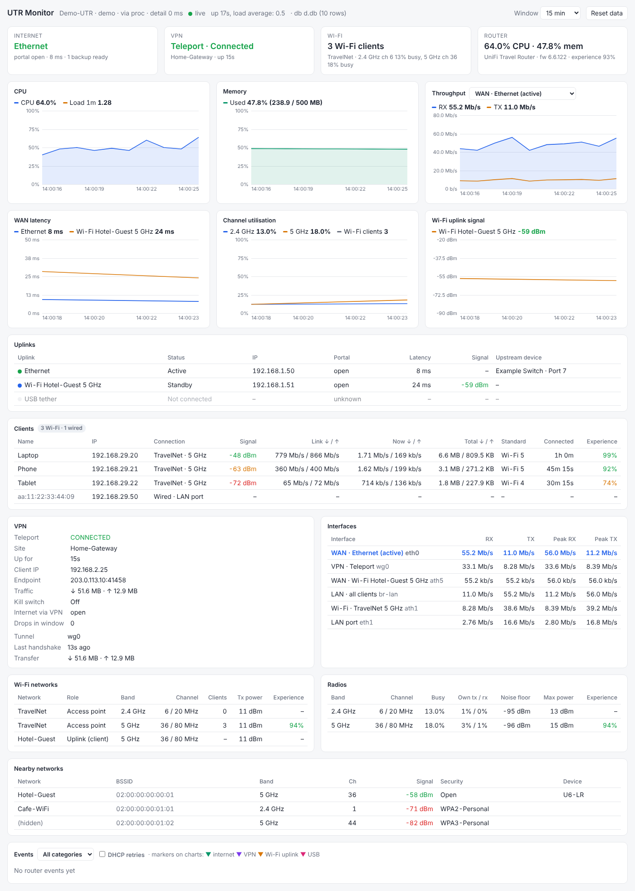

# utr-monitor

Live CPU, memory and network throughput graphs for a **UniFi Travel Router (UTR)**.

The UTR's management UI shows very little, but the device has an SSH CLI with a
BusyBox shell. `utr-monitor.py` logs in over SSH, polls the router every few
seconds and serves a local web page with live charts.



## Features

- CPU %, 1-minute load average, memory used (% and MB)
- Per-interface RX/TX throughput in bits per second, with a picker and a table of current and peak rates
- Hover crosshair on all charts; 5 min / 15 min / 1 hour / all-history windows
- Self-contained page: no CDN or internet access needed, so it works when you're
  only connected to the travel router
- History saved to SQLite by default, reloaded on restart, and a **Reset data** button in the UI to clear it
- CSV export of the full history
- Automatic reconnect with backoff if the SSH session drops
- `--demo` mode with synthetic data for trying the UI without a device

## Requirements

- Python 3.8+
- [paramiko](https://www.paramiko.org/)
- SSH enabled on the UTR, and the device SSH password (user `ui` by default)

## Setup

```bash
python3 -m venv my-venv
source my-venv/bin/activate
pip install paramiko
```

## Usage

```bash
python3 utr-monitor.py 192.168.1.1          # prompts for the SSH password
```

Then open <http://127.0.0.1:8080/>.

Other ways to supply the password:

```bash
UTR_PASSWORD='secret' python3 utr-monitor.py 192.168.1.1
python3 utr-monitor.py 192.168.1.1 -p 'secret'   # visible in shell history / ps
```

Try the UI without a router:

```bash
python3 utr-monitor.py --demo
```

### Options

| Option | Default | Description |
|---|---|---|
| `host` | – | UTR IP address or hostname (not needed with `--demo`) |
| `-u`, `--user` | `ui` | SSH username |
| `-p`, `--password` | – | SSH password (else `$UTR_PASSWORD`, else prompt) |
| `--ssh-port` | `22` | SSH port |
| `-i`, `--interval` | `2` | Poll interval in seconds (minimum 0.5) |
| `--history` | `3600` | Samples kept in memory (3600 × 2 s ≈ 2 hours) |
| `--iface NAME` | all except `lo` | Track only this interface; repeat for more |
| `--bind` | `127.0.0.1` | Web server bind address; use `0.0.0.0` for LAN access |
| `--port` | `8080` | Web server port |
| `--db PATH` | `utr-monitor-<host>.db` | SQLite file for history, in the current directory |
| `--no-db` | off | Don't persist; keep history in memory only |
| `--retention-days` | `30` | Delete DB rows older than this; `0` keeps everything |
| `--demo` | off | Generate fake data instead of connecting |
| `-v`, `--verbose` | off | Debug logging |

### Endpoints

| Path | Returns |
|---|---|
| `/` | The dashboard |
| `/api/data?since=<epoch>` | JSON: connection status and samples newer than `since` |
| `/api/export.csv` | Full history as CSV (from the DB when enabled; throughput in bits/s) |
| `POST /api/reset` | Clears in-memory and DB history (needs header `X-UTR-Reset: 1`; the UI button sends it) |

## How it works

On each poll the script runs one compound command on the router and parses the output.

1. **`/proc` method (preferred):** reads `/proc/stat`, `/proc/meminfo`,
   `/proc/net/dev` and `/proc/loadavg`. CPU and throughput are computed from
   counter deltas between polls, so the first poll after connecting only primes
   the counters and isn't plotted.
2. **`top` fallback:** if `/proc` can't be read, it parses `top -bn1` for CPU,
   memory and load, plus `/proc/net/dev` or `ifconfig` for interface counters.

Memory "used" excludes buffers and page cache (it's `MemTotal − MemAvailable` where available).

The SSH session first tries normal exec channels. If the UTR's restricted
shell rejects them, it switches to a single interactive shell and frames each
command's output with unique markers.

The page header shows which method is in use and whether the connection is live.

### Persistence

Each sample is written to a SQLite `samples` table (WAL mode), with interface
rates stored as a JSON column. By default the file is named after the host, so
monitoring different routers keeps their history separate. On startup the most
recent `--history` samples are loaded back into the charts, and lines break
across gaps such as restarts rather than joining them up.

`--demo` doesn't write to a DB unless you pass `--db`, so fake data never ends
up mixed with real history.

**Reset data** asks for confirmation, then deletes all rows and compacts the
file. Other open browser tabs pick up the reset on their next poll.

## Caveats

- With `--no-db`, history lives in memory only and is lost when the script stops.
- The charts show at most the last `--history` samples. Older rows stay in the
  DB (up to the retention limit) and are included in the CSV export.
- At the default 2 s interval the DB grows by roughly 43,000 rows a day, a few MB.
- With the `top` fallback, some BusyBox builds report CPU averaged since boot
  rather than the current value. Run with `-v` to see what's being collected.
- Host keys are accepted automatically (`AutoAddPolicy`), since travel routers
  are often reset or re-adopted. Don't use this on a network you don't trust.
- The web server has no authentication, and anyone who can reach it can reset
  the history. Keep the default `127.0.0.1` bind unless you need LAN access.
- Interface counters that reset or wrap are skipped for that sample rather than
  shown as a spike.
