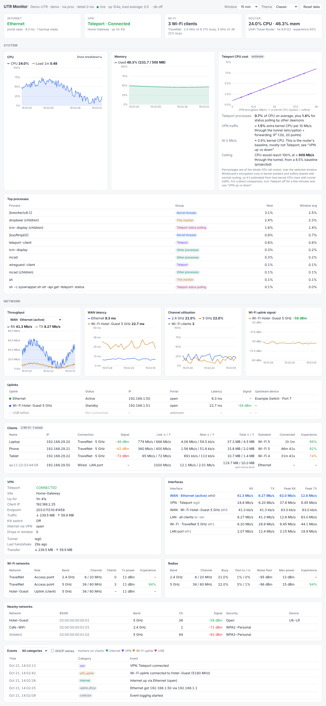
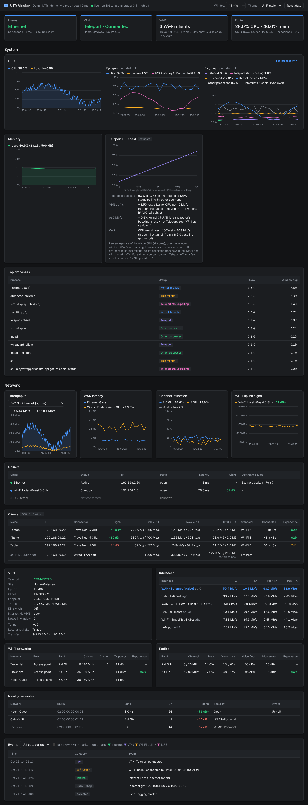

# utr-monitor

A live local dashboard for a **UniFi Travel Router (UTR)**: CPU, memory,
throughput, WAN uplinks and latency, Teleport VPN status, Wi-Fi networks and
clients, and the router's own event log.

The UTR's management UI shows very little, but the device has an SSH CLI with a
BusyBox shell and UniFi's own status tools. `utr-monitor.py` logs in over SSH,
polls the router and serves a web page with live charts and tables.

| Classic theme | UniFi style theme (CPU breakdown expanded) |
|---|---|
|  |  |

Screenshots use `--demo` data.

`utr-probe.py` is a companion read-only discovery tool: it runs a fixed set of
commands on the router and writes a report (secrets redacted) showing what your
firmware exposes.

## Features

- **Status tiles:** internet (active WAN, captive-portal state, latency), VPN,
  Wi-Fi clients and router load at a glance
- **Charts:** CPU and load, memory, throughput, WAN latency, channel
  utilisation and Wi-Fi uplink signal, with a shared hover crosshair and
  5 min / 15 min / 1 h / 6 h / all windows
- **Named interfaces:** the throughput picker shows "WAN · Ethernet (active)",
  "WAN · Wi-Fi <network> 5 GHz", "VPN · Teleport", "Wi-Fi · <network> 2.4 GHz",
  "LAN port" and so on, and hides kernel plumbing interfaces
- **Uplinks:** every WAN candidate (Ethernet, Wi-Fi client, USB tether) with
  status, IP, portal state, latency, signal and the upstream device it's
  plugged into (from LLDP)
- **VPN:** Teleport state, site, uptime, traffic, kill switch and drops in the
  current window; WireGuard handshake age and transfer
- **Clients:** name, IP, network and band, signal, link rates, live and total
  traffic, Wi-Fi standard, connected time and UniFi's experience score; wired
  LAN clients with port link speed and traffic
- **Wi-Fi networks and radios:** channel, width, client count, transmit
  power, channel utilisation, noise floor
- **Nearby networks** from the radio scan tables
- **CPU accounting:** CPU split by type (user, system, IRQ + softirq) and by
  group (Teleport, Teleport status polling, this monitor, kernel threads,
  other, interrupts and short-lived processes), a top-processes table, and an
  estimate of Teleport's CPU cost
- **Events:** the router's `utr-runtime-events.log` (internet up/down, Wi-Fi
  uplink, DHCP, VPN, USB tether, Bluetooth) as a filterable timeline, with
  markers on the charts
- Two themes, switchable from the header and remembered per browser: **Classic** (default)
  and **UniFi style**, a dark network-console look. Classic follows the system light/dark setting
- Self-contained page: no CDN or internet access needed, so it works when you're
  only connected to the travel router
- History saved to SQLite by default, reloaded on restart, and a **Reset data** button in the UI to clear it
- CSV export of the full history
- Automatic reconnect with backoff if the SSH session drops
- `--demo` mode with synthetic data for trying the UI without a device

## Requirements

- Python 3.8+
- [paramiko](https://www.paramiko.org/)
- Optional: [keyring](https://pypi.org/project/keyring/), to remember the SSH password in the system keychain
- SSH enabled on the UTR, and the device SSH password (user `ui` by default)

## Setup

```bash
python3 -m venv my-venv
source my-venv/bin/activate
pip install -r requirements.txt     # paramiko, plus keyring to remember the password
```

## Usage

```bash
python3 utr-monitor.py 192.168.1.1          # prompts for the SSH password
```

Then open <http://127.0.0.1:8080/>.

Other ways to supply the password:

```bash
UTR_PASSWORD='secret' python3 utr-monitor.py 192.168.1.1
python3 utr-monitor.py 192.168.1.1 -p 'secret'   # visible in shell history / ps
```

### Saved password

With `keyring` installed, the password you type is saved to the system
keychain (macOS Keychain, Windows Credential Manager, or the Secret Service on
Linux) once the login succeeds. Later runs, and `utr-probe.py`, use it without
asking. It's stored per `user@host`, under the service name `utr-monitor`.

It's stored encrypted by the OS rather than hashed: SSH needs the real password
each time, so a one-way hash couldn't be used to log in.

If the router's password changes, the monitor notices the saved one being
rejected, removes it and asks again. To reset it yourself:

```bash
python3 utr-monitor.py 192.168.1.1 --forget-password
# or, on macOS:
security delete-generic-password -s utr-monitor -a ui@192.168.1.1
```

You can also open **Keychain Access**, search for `utr-monitor` and delete the
entry. `--no-save-password` stops a typed password from being saved.
`--password` and `$UTR_PASSWORD` take priority and are never saved.

Try the UI without a router:

```bash
python3 utr-monitor.py --demo
```

### Options

| Option | Default | Description |
|---|---|---|
| `host` | – | UTR IP address or hostname (not needed with `--demo`) |
| `-u`, `--user` | `ui` | SSH username |
| `-p`, `--password` | – | SSH password (else `$UTR_PASSWORD`, else the saved one, else prompt) |
| `--ssh-port` | `22` | SSH port |
| `--no-save-password` | off | Don't save a typed password to the keychain |
| `--forget-password` | – | Remove the saved password for `user@host` and exit |
| `-i`, `--interval` | `2` | Fast poll interval in seconds (minimum 0.5) |
| `--detail-interval` | `10` | Seconds between UniFi detail polls (minimum 5); `0` turns them off |
| `--history` | `3600` | Points kept in memory per series (≈ 2 h of fast samples, 10 h of detail) |
| `--iface NAME` | all except `lo` | Track only this interface; repeat for more |
| `--bind` | `127.0.0.1` | Web server bind address; use `0.0.0.0` for LAN access |
| `--port` | `8080` | Web server port |
| `--db PATH` | `utr-monitor-<host>.db` | SQLite file for history, in the current directory |
| `--no-db` | off | Don't persist; keep history in memory only |
| `--retention-days` | `30` | Override the 30-day history (`0` keeps everything; see Persistence) |
| `--once` | off | Run one detail poll, print the parsed state as JSON and exit |
| `--demo` | off | Generate fake data instead of connecting |
| `-v`, `--verbose` | off | Debug logging |

### Endpoints

| Path | Returns |
|---|---|
| `/` | The dashboard |
| `/api/data?since=&dsince=&eseq=` | JSON: status, fast samples, detail points and events newer than the cursors, plus the current state |
| `/api/state` | JSON: the latest parsed router state only |
| `/api/export.csv` | Full history as CSV (from the DB when enabled; throughput in bits/s) |
| `POST /api/reset` | Clears in-memory and DB history (needs header `X-UTR-Reset: 1`; the UI button sends it) |

## How it works

The script runs two polls over the same SSH session.

**Fast poll** (every `--interval`, default 2 s): one compound command for CPU,
memory and interface counters.

1. **`/proc` method (preferred):** reads `/proc/stat`, `/proc/meminfo`,
   `/proc/net/dev` and `/proc/loadavg`. CPU and throughput are computed from
   counter deltas between polls, so the first poll after connecting only primes
   the counters and isn't plotted.
2. **`top` fallback:** if `/proc` can't be read, it parses `top -bn1` for CPU,
   memory and load, plus `/proc/net/dev` or `ifconfig` for interface counters.

Memory "used" excludes buffers and page cache (it's `MemTotal − MemAvailable` where available).

**Detail poll** (every `--detail-interval`, default 10 s) reads UniFi's own tooling:

| Source | Used for |
|---|---|
| `mca-dump` | Active uplink, portal detection, LLDP neighbours, Wi-Fi networks and per-client stats, radio utilisation and scan tables, system stats |
| `/tmp/teleport-client.d/connection-status.json` | Teleport VPN state |
| `wg show all latest-handshakes` / `transfer` | WireGuard handshake age and traffic (no keys are read) |
| `/var/run/unifi_mwan.status.ping.*` | Per-WAN latency from the multi-WAN health checks. A connected WAN with no file means its checks are failing ("no reply") |
| `/tmp/leases.*`, `/proc/net/arp` | Client hostnames and wired LAN clients |
| `/var/log/utr-runtime-events.log` | Event timeline. Times come from boot time plus each event's monotonic counter, and events are de-duplicated by boot ID and line |
| `ip route`, `ip addr`, `/proc/net/wireless` | Default-route fallback, WAN addresses, live uplink signal |

The detail poll also snapshots `/proc/stat`, every `/proc/<pid>/stat`, `ps w`
and `/proc/net/dev`, and diffs them against the previous poll:

- Live processes contribute their own CPU time. Children that exited are
  credited to their parent, minus anything already counted while they were
  visible, so nothing is counted twice.
- **Teleport** is `teleport-client`, `wireguard-client`, `openvpn-client`,
  the Teleport `dnsmasq` and `wg-crypt-*`. **Teleport status polling** is
  other daemons (for example the LCD) running `utr-api get-teleport-status`
  scripts; it's an estimate, since those parents may run other scripts too.
  **This monitor** is the dropbear session serving the monitor and
  everything it runs, including `mca-dump`.
- WireGuard encrypts in kernel workers and softirq shared with ordinary
  routing, so the **Teleport CPU cost** panel fits kernel CPU (system +
  softirq) against tunnel throughput: the slope is the cost per 10 Mb/s and
  the intercept is the idle-tunnel cost. When non-VPN traffic varies
  independently, a second term separates the encryption premium from plain
  forwarding. With data from both VPN-up and VPN-down periods in the
  window, it also compares total CPU directly.

All CPU percentages are of the whole machine (all cores).

Each part degrades on its own: if `mca-dump` isn't available, the VPN, latency
and event panels still work. The header shows how long the detail poll took.
`--once` prints one parsed detail poll as JSON, which is the quickest way to
check what the script sees on your firmware.

The SSH session first tries normal exec channels. If the UTR's restricted
shell rejects them, it switches to a single interactive shell and frames each
command's output with unique markers.

The page header shows which method is in use and whether the connection is live.

### Persistence

Fast samples go to a `samples` table, detail series (latency, channel
utilisation, uplink signal, client count, VPN up) to `details`, and router
events to `events`, all in one SQLite file (WAL mode). The current state shown
in the tables isn't stored; it refreshes on the next detail poll. By default the file is named after the host, so
monitoring different routers keeps their history separate. On startup the most
recent `--history` samples are loaded back into the charts, and lines break
across gaps such as restarts rather than joining them up.

History is kept for **30 days** and then deleted. A travel router rarely
stays up longer than a few days to a week, so that covers several trips.
Data is kept at full resolution for the whole period. Downsampling older
data (for example to 1-minute averages after N days, with the cut-off
configurable) is planned future work.

`--demo` doesn't write to a DB unless you pass `--db`, so fake data never ends
up mixed with real history.

**Reset data** asks for confirmation, then deletes all rows in all three tables and
compacts the file. Events already in the router's log aren't re-imported afterwards. Other open browser tabs pick up the reset on their next poll.

## Development

```bash
pip install -r requirements-dev.txt
pytest
```

The suite runs against fictional router output (`tests/helpers.py`) and fake
SSH sessions, so it needs no router. It enforces at least 90% coverage of both
scripts, branches included. With `node` installed it also runs the dashboard's
JavaScript against hostile router strings to check everything is escaped.

Design decisions and working agreements are in [AGENTS.md](AGENTS.md).

## Caveats

- With `--no-db`, history lives in memory only and is lost when the script stops.
- The charts show at most the last `--history` samples. Older rows stay in the
  DB (up to the retention limit) and are included in the CSV export.
- While the monitor runs, the DB grows by roughly 25–30 MB a day at full
  resolution. A week-long trip is around 200 MB; the 30-day limit caps it
  at around 800 MB.
- `mca-dump` is the heaviest command the script runs. If the router's CPU climbs noticeably, raise `--detail-interval`.
- The detail parsing was written against UTR firmware 6.6.122. Other versions may name fields differently; `--once` shows what's being picked up.
- With the `top` fallback, some BusyBox builds report CPU averaged since boot
  rather than the current value. Run with `-v` to see what's being collected.
- Host keys are accepted automatically (`AutoAddPolicy`), since travel routers
  are often reset or re-adopted. Don't use this on a network you don't trust.
- The web server has no authentication, and anyone who can reach it can reset
  the history. Keep the default `127.0.0.1` bind unless you need LAN access.
- Wired clients' traffic comes from the LAN port's counters, since the router
  doesn't count per wired device. With one device on the port it's exact; with
  several, each shows the shared port total, labelled as such.
- Interface counters that reset or wrap are skipped for that sample rather than
  shown as a spike.
